# Kindred

[](https://github.com/niklas-heer/kindred/actions/workflows/ci.yml)
[](LICENSE)
[](https://github.com/niklas-heer/kindred/releases)

Kindred is a family tree that a whole family shares, with the stories, photographs and places that go with it. You run it
yourself, each family lives in its own database, and you can take it with you whenever you like.

**[Try the demo](https://kindred-demo.niklas-heer.workers.dev)**: two invented families, read-only, nothing to sign up for. The demo offers the **grand tour** first: a walk through everything Kindred does, on those families.

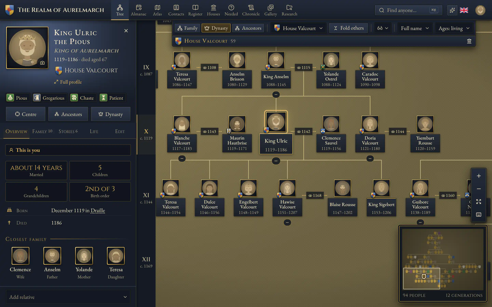

In most families, one person keeps the records, in a folder or a program nobody else can open. Kindred puts them somewhere
everyone can reach. Relatives can find themselves, see how they are related to the great-aunt in the old photograph, and
add what they remember: a saying, a recipe, the name of the village.

## Why a family comes back

A tree gets one look. These are the parts meant to be opened again next week.

**Today** is the first page of every family, and its common room. The family's feed leads: what relatives wrote to each
other, new memories and photographs, who was added to the tree. Beside it are the week's question, the day's quiz, the
week's birthdays and wedding anniversaries, and what is new since your last visit.


- **The family's feed.** A relative writes a few lines to the family ("We have moved", "She passed her exam", "Photos from
  Sunday"), with pictures and the people it is about. Everyone can react, contributors can comment, and the message also
  shows on the page of whoever it is about. New memories, a day's photographs and new people in the tree join the same
  stream, so one page says what the family has been up to. The feed also says when records change, with the new value
  ("Ada updated Carl: new phone number +49 30 …, born 3 May 1950 in Graz"): a number you can call, an address that opens
  the map, the start of a biography. Each reader sees only the values they could see on the person's page; old values,
  removed values and medical or faith notes are never shown. A device can be told about a new message, at most once in a
  few hours.

- **The question of the week.** One question for the whole family ("What did the kitchen of your childhood look like?"),
  chosen from sixty written for the purpose, in every language Kindred speaks. A relative answers in a few sentences, about
  themselves or about anyone in the tree, and the answer is kept as a memory in the Chronicle.
- **The daily quiz.** "Do you know your family?" asks one question a day made from the family's own records: whose shield
  this is, who this is, who someone's parents were, where someone was born, who came first. Everyone gets the same question, you
  get one try, and it keeps a streak. It never asks about a cause of death.
- **The Campaign.** Rule your house for 12 turns against the family's other houses, on an invented continent drawn fresh
  each week: plains, forests, highlands, marshes, rivers, mountain ridges, sea lanes, towns and castles, all with invented
  names. Each turn you place troops, give up to three orders and see your exact chance before you attack; marches, battles
  and conquests are animated, and a reign ends with a short chronicle and a title. The whole family plays the same continent
  each week: the first reign you begin each day counts for the family's table (you can continue it on any device), and
  more reigns are practice with a personal best. Recording the family raises your renown and your levy. It never changes the
  family's records, and a steward switches it on.
- **Who is this?** Photographs nobody has tagged become a two-minute game. Anyone can suggest who is in a picture, and a
  contributor or editor confirms it.
- **Talking to each other.** Members answer a message, a memory, a photograph or an update with an emoji, from a quick row
  or a searchable palette, and contributors can comment. The one who wrote it sees the replies under "What's new", and can
  choose a push notification about them. The emoji data ships with Kindred, so the palette asks no outside server.
- **Here now.** Members see who of the family is in Kindred with them, on which page, and whom they have selected. "Show me
  to others" in the account menu stops sharing. Guests never see it.

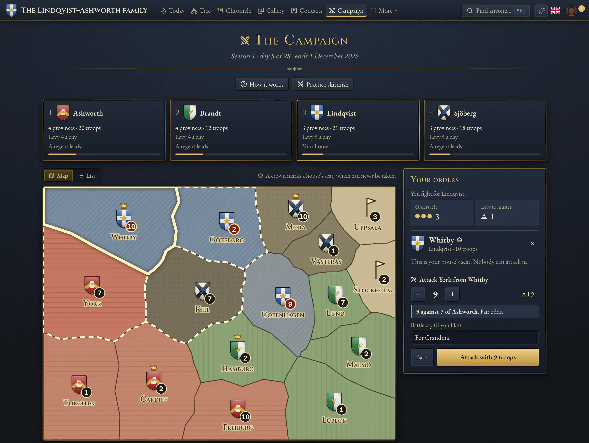

[docs/feed.md](docs/feed.md), [docs/today.md](docs/today.md), [docs/campaign.md](docs/campaign.md),
[docs/who-is-this.md](docs/who-is-this.md), [docs/responses.md](docs/responses.md) and
[here now](docs/roles-and-privacy.md#here-now) have the rules.
A guest of a share link sees none of this. A guest can, however, ask for an account of their own, and the stewards decide.

## What a researcher gets

A person's page holds their life on a timeline, their relatives, what has been written about them, and a drawn portrait.

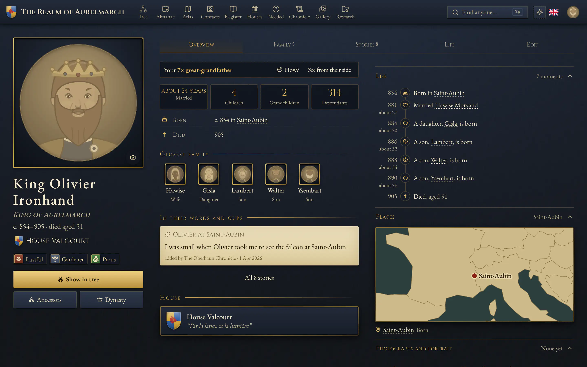

Click the portrait and a **character editor** opens, as in a game: skin, hair and beard in any colour, eyes, glasses, a beard chosen by coverage, length and cut (the moustache separately), headwear from a flat cap
to a hijab or a crown, clothes for every day and for a wedding, a hearing aid, a backdrop. "Surprise me" makes a believable
relative of the same age and time, and ready-made looks such as "Grandfather, 1950s" dress them in one click. Every relative, of
any origin, age, faith and era, can be made to look like themselves. [docs/portraits.md](docs/portraits.md) has the details.

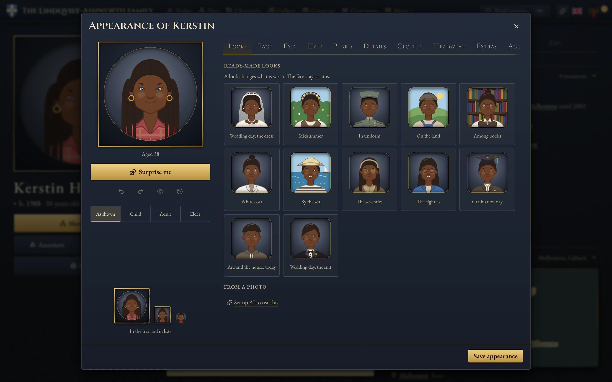

- **Quick editing.** On a person's Edit tab each field folds to one line, and only the one you open is edited. An address
  completes as you type, from OpenStreetMap through the Photon service; set `KINDRED_ADDRESS_LOOKUP=off` to send no address anywhere.
- **Life events.** Baptism, schooling, service, moves, burial and more (or an event of your own), each with a date, a place and a
  note, in order on the timeline with births, partnerships and death. Places appear in the Atlas.
- **Sources.** The family's registers, letters, books and web pages are listed once and cited for a birth, a death, a name, an event,
  a partnership or a parent link, with the page, how good the source is and a short transcription. Cited facts carry a small mark,
  and the Needed page lists births that have none.
- **History.** Every change to the records is kept with who made it and what it was before. A History page filters by person, kind
  and author, and an editor can put an earlier name, date, place or biography back. Private details leave no content in it.
- **GEDCOM and a Markdown archive.** Export and import carry events and sources, and Kindred's own export comes back unchanged.
- **Print.** An ancestor chart, a descendant chart or a family book: a cover with the family's arms, a section for each house, a page
  for every person with their life, memories and sources, and a register of names at the back. A4 or Letter. Your browser prints it
  or saves it as a PDF, and nothing is made on the server.
- **Research** gathers one question, such as where a branch came from, with its documents, pictures, notes, people and places on one timeline.

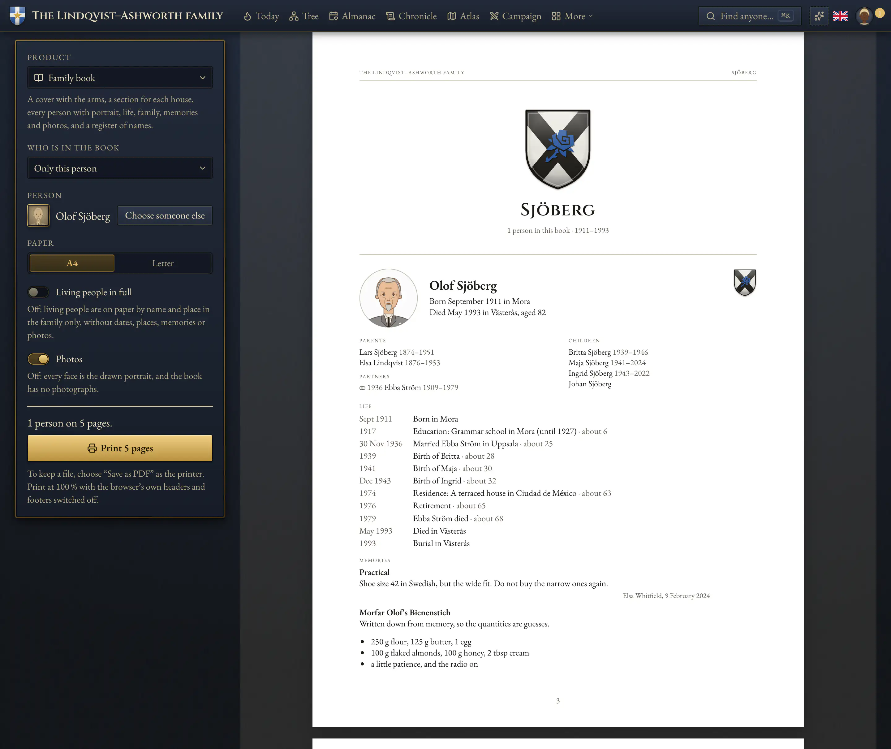

## Finding your way around the family

The tree opens on one person and the people around them. **Family** is an hourglass of ancestors and descendants,
**Dynasty** follows a house down the generations, and **Ancestors** looks straight back. Zoom out and the cards become name
plates, then shields that keep each person's name, then shields alone, and a **minimap** always shows the whole family and
where you are in it.

Press ⌘K or `/` (on a phone, the search icon) to find people by name, nickname, title or house, with their years and face, and also houses, places and pages. Accents are ignored, so "Muller" finds "Müller". Each person says how they are related to you. A lens
dims everyone except a direct line, a house, the living, or the path between two people. On a phone the person panel becomes
a drawer under the tree, and the sections move to a tab bar: Today, Tree, Gallery, Contacts and More.

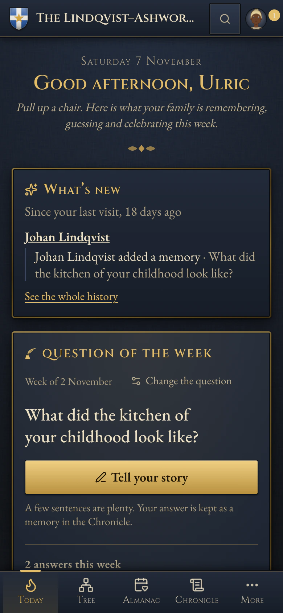

## Houses and their arms

A branch of the family can be a **house**, with a shield, a motto, a head and a line of succession. You draw the arms in a
designer, with its choices of field, division, charges and tinctures explained as you go. The assistant can look up what a surname means and offer the possible origins for you to choose from, then say
whether the arms suit that meaning and suggest new designs.

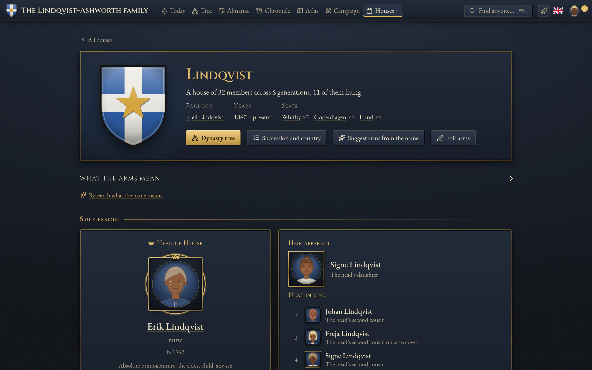

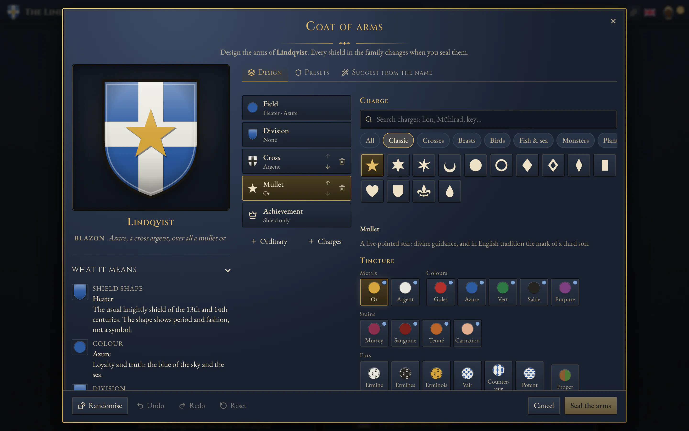

## What the family remembers

- The **Chronicle** gathers the family's notes, sayings, anecdotes, recipes and memories.
- The **Cookbook** lists the family's recipes. A recipe has ingredients in rows (type or paste a line and it sorts itself into
  amount, unit and item), numbered steps, servings, times, tags and where it comes from ("Grandma's"). Its page scales the
  amounts, lets you tick off ingredients, has a cooking mode that keeps the screen awake, and prints as one sheet. Its
  picture stays with the recipe and is not in the Gallery. See [docs/recipes.md](docs/recipes.md).
- The **Gallery** holds photographs and albums, with the people in them tagged. AI can suggest faces, and a person confirms each one.
- The **Atlas** maps where the family was born, married and died, and replays them spreading out over the years.
- The **Almanac** keeps birthdays, anniversaries and memorial days, for your calendar or as reminders on your devices, next to an
  address book grouped by household.
- **Needed** is the to-do list of what is still missing, nearest relatives first, one question at a time if you like.

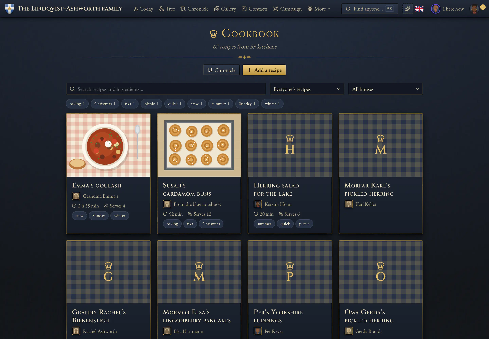

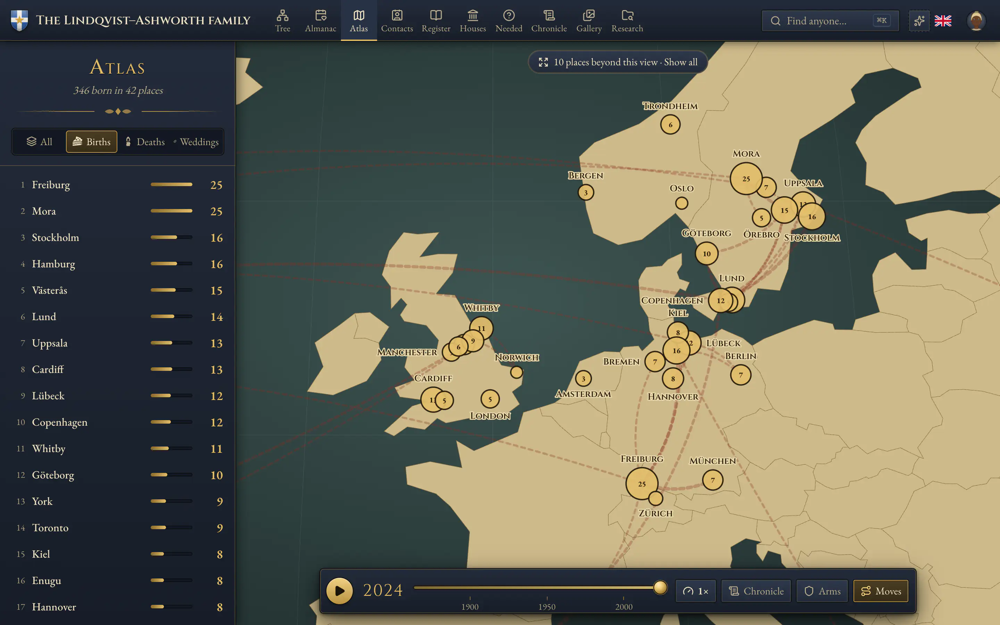

## The assistant, if you want one

AI is optional, and nothing is sent anywhere until a steward adds a key and turns a feature on. The assistant answers
questions about the family in plain words and proposes changes, which you approve yourself. Background tasks can collect
name meanings, review arms and translate stories, each with its own switch.

You can connect Anthropic, OpenAI and OpenRouter, and choose a provider and model for each job. The family shares one monthly
budget, $5 by default. [docs/ai.md](docs/ai.md) says exactly what is sent where.

## Tours

Kindred explains itself on your own family. New members are offered **Welcome**, a two-to-three-minute tour of what matters
on the first day. **The grand tour** walks through everything else in chapters you can skip, pause and pick up again. Some
steps ask you to try the thing yourself, and "Show me" does it for you. Tours only show and never change your family's
records, so they also work in the public demo and in a steward's preview. Both are under **Tours** in the account menu.
[docs/tours.md](docs/tours.md) has the details.

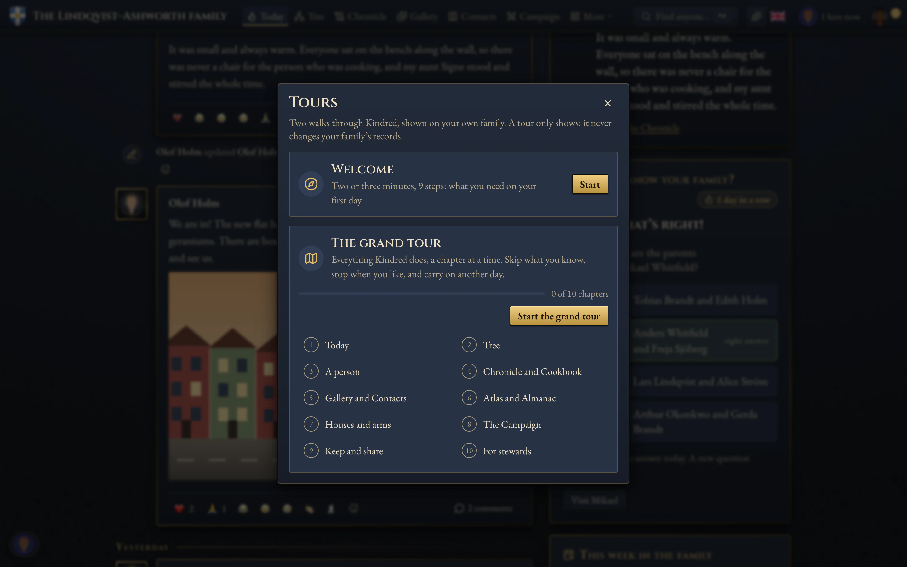

## Who sees what

People sign in with a **passkey** by default. The operator can also offer a **username and password** (with two-step codes and recovery codes) and **single sign-on** through any OpenID Connect provider (Google, Microsoft Entra, Authentik, Keycloak), in any combination; one account can have several ways in. Failed guesses are limited across the whole server. If you already manage people in Cloudflare, you can make Cloudflare Access the only sign-in instead ([choosing how people sign in](docs/self-host.md#choosing-how-people-sign-in)).
A member is a viewer, contributor, editor or steward, and the server checks every change. A person's fields and notes have three levels: personal (only the
account that added them), editors, or the whole family. A relative who doesn't want an account can have a read-only **share link**, protected by a password by default, that by default shows living people only by name, face and place in the tree. A guest can ask the stewards for an account of their own from it; to show the stewards how the link was used, a guest's visit is counted in a few totals, never with a page log or an address, and not at all under Do Not Track.

Stewards get counts-only **statistics**, which never hold names or what anyone
wrote and can be turned off, and a **feedback** inbox that stays inside the family's own Kindred. Every member can download
what their account holds or delete it, and stewards can answer a relative's data request (a copy, a restriction, or erasure
everywhere in the family); [docs/gdpr.md](docs/gdpr.md) says what Kindred does for each right.

Kindred speaks **eleven languages**: English, German, Afrikaans, Spanish, French, Italian, Dutch, Polish, Brazilian
Portuguese, Japanese and Simplified Chinese, including the words for relatives ("your great-aunt") in each, and comes in the
Codex, Paper and Night themes. [docs/translating.md](docs/translating.md) says how a language is added and checked.

[docs/roles-and-privacy.md](docs/roles-and-privacy.md) has the details.

## Try it

With Docker, from a copy of this repository, there is nothing else to install:

```sh
git clone https://github.com/niklas-heer/kindred && cd kindred
docker compose up -d --build   # then open http://localhost:4901/setup
```

Create the first account with a passkey. The first account becomes steward of every family that exists, and you invite
everyone else from the Access page. Passkeys need HTTPS or `localhost`. From the next release, a ready-made image
(`ghcr.io/niklas-heer/kindred`) skips the build: see [docs/self-host.md](docs/self-host.md).

To work on Kindred, or to run it from source, you need [mise](https://mise.jdx.dev), which installs the right version of Node:

```sh
mise install && mise run install   # `mise run install` is npm install, run with that Node
mise run data                      # optional: two invented families to explore
mise run dev                       # http://localhost:4517
```

If mise is not activated in your shell, run every command as `mise run <task>`, so the right Node is used. The invented
families from `mise run data` appear after you create the first account.

## Running it for your family

Kindred's own accounts (the default) need nothing more than HTTPS: passkeys, and whichever other ways in the operator turns on
in the console. `KINDRED_AUTH=cloudflare-access` hands sign-in to a Cloudflare Access policy you manage instead.

- **Docker**, on your own machine or server: `docker compose up -d --build` (or, from the next release, a published image), then open <http://localhost:4901/setup>. Each family is a SQLite file. See [docs/self-host.md](docs/self-host.md), which also covers HTTPS, backups and reminders.
- **Node**, without a container: `mise run build:node && mise run start`, on Node 26.
- **Cloudflare**, with Workers, Durable Objects and R2 and no server to look after: each family gets its own storage when it
  is made, with no redeploy, and can be kept in the EU. See [docs/deploy-cloudflare.md](docs/deploy-cloudflare.md), or
  start from the button (it needs the Workers Paid plan; the guide walks through the first run):

  [](https://deploy.workers.cloudflare.com/?url=https://github.com/niklas-heer/kindred)

A steward can make more families, or delete one, on the Families page.

**Hosting families for other people.** One Kindred server can host many families, run by an **operator**: an instance role,
not a family's, that sees how each family is run (its size, storage and stewards) but none of its records. The operator
console at `/operator` makes a family for someone and hands them a steward invitation, keeps a waiting list from a public
request form (with optional Cloudflare Turnstile), handles data requests from relatives who never signed up, sets storage
caps, can make a family read-only or close it, keeps an audit log, and holds the Impressum, privacy policy and terms that
the server shows. A setting decides who may make families: the operator, any steward, anyone by request, or anyone who signs
up (with limits, sign-up codes and a readiness checklist). In **hosting mode** the server greets visitors with a landing page.

The operator also decides, feature by feature, which families may use the Campaign, the assistant, painted portraits,
address suggestions and push, and may offer AI on the operator's own key with per-family and server-wide monthly budgets.
**Announcements** reach stewards or everyone. **Statistics** show how the server grows (counts only, never anyone's records),
a **Health** tab shows the daily jobs and backups, and the console says when a new Kindred release is out; installs made with
the Deploy button update with one click. The **Privacy** tab holds the record of processing, the subprocessors, the breach
register and a retention job, and the server can offer a processing agreement ([template](docs/processing-agreement.md)).
The server **backs every family up itself**, every night and encrypted, and a weekly restore test proves the backups
work; the **Backups** tab restores a family or rolls it back to before an update (keep a copy of the backup key somewhere
other than the server). Families nobody uses any more can be warned, made read-only and removed on a schedule the operator
sets (off by default). **Email** is optional (Resend, Postmark, Mailgun or SMTP), set up in the console: confirmed
addresses, password resets, security notices, invitations and notices to operators and stewards.
Members see what is new in each release under **New in Kindred**. See [docs/hosting-many-families.md](docs/hosting-many-families.md). `KINDRED_DEMO=1` runs a read-only demo of the invented
families that anyone can open without signing in ([docs/self-host.md](docs/self-host.md#a-public-demo)).

## Your data is yours

Every family is one database you can read: a SQLite file on Node, a Durable Object (or a D1 database) on Cloudflare. Editors and stewards can export
a family as GEDCOM 5.5.1, for other genealogy programs, or as a Markdown archive. Stewards can import a GEDCOM file, and see
a preview before anything is written. An optional nightly archive can copy each family to a private GitHub repository.
[docs/exchange.md](docs/exchange.md) says what each format keeps and drops.

Exports leave some things out, so back up the databases and pictures as well.

## Documentation

- [Self-hosting](docs/self-host.md) and [deploying on Cloudflare](docs/deploy-cloudflare.md)
- [The AI features](docs/ai.md): what they send, what they cost, and how keys are kept
- [Roles and privacy](docs/roles-and-privacy.md)
- [Hosting many families](docs/hosting-many-families.md): the operator, sign-up, policies, statistics, updates, data requests and legal pages
- [Data protection](docs/gdpr.md) and a [processing agreement template](docs/processing-agreement.md)
- [Translating Kindred](docs/translating.md)
- [The family feed](docs/feed.md): messages to the family, and the stream on Today
- [Today](docs/today.md): the question of the week and the daily quiz
- [Drawn portraits](docs/portraits.md): the character editor, what a portrait can say, and who may change one
- [The Campaign](docs/campaign.md): a reign you play alone as your house on an invented continent, with weekly family scores
- [Recipes and the Cookbook](docs/recipes.md)
- [Who is this?](docs/who-is-this.md): naming people in untagged photographs
- [The tours](docs/tours.md): Welcome and the grand tour
- [Reactions and comments](docs/responses.md): answering messages, memories and photographs
- [GEDCOM and the Markdown archive](docs/exchange.md)
- [The data model](docs/data-model.md)
- [Changelog](CHANGELOG.md), [release notes for 2.0.0](docs/releases/v2.0.0.md), [2.3.0](docs/releases/v2.3.0.md), [2.4.0](docs/releases/v2.4.0.md) and [2.5.0](docs/releases/v2.5.0.md) and [moving from v1](docs/migration-plan.md)
- [The model evaluations](docs/evals/README.md) behind the AI recommendations

Version 2 is a web app that replaces the earlier Rust CLI and its Markdown archive. It is a migration, not an upgrade.

## Working on Kindred

Kindred is TanStack Start with React 19, on `node:sqlite` or D1 behind one small storage interface.

```sh
mise tasks       # every task, with what it does
mise run check   # the types
mise run test    # the unit tests
mise run e2e     # browser journeys, on scratch data
```

[CONTRIBUTING.md](CONTRIBUTING.md) says how to send a change, and [AGENTS.md](AGENTS.md) holds the conventions. Schema changes are new numbered files in `migrations/`, and a file that has shipped is never edited. English text lives in
`src/lib/i18n/areas/`, and each other language in `src/lib/i18n/locales/<language>/`; [src/lib/i18n/README.md](src/lib/i18n/README.md) says how to add a string.

## Licence and credits

Kindred is open source under the [MIT licence](LICENSE).

- Heraldic charges come from [game-icons.net](https://game-icons.net), under **CC BY 3.0**, by Lorc, Delapouite and contributors.
- Portraits are Kindred's own drawing, built from parts in `src/components/portrait/`. Painted portraits, if a steward turns them on, are made by the image model they choose.
- Place names for the offline gazetteer come from [GeoNames](https://www.geonames.org), under **CC BY 4.0**.
- Typefaces come from Fontsource: Cinzel, EB Garamond, Inter and IM Fell English, under the SIL Open Font License.
- The Atlas draws its map from `world-atlas`, which is built from Natural Earth data.

[NOTICE.md](NOTICE.md) lists every third-party licence and the credit each one asks for.
