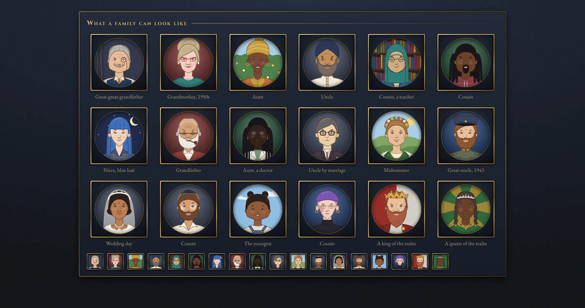
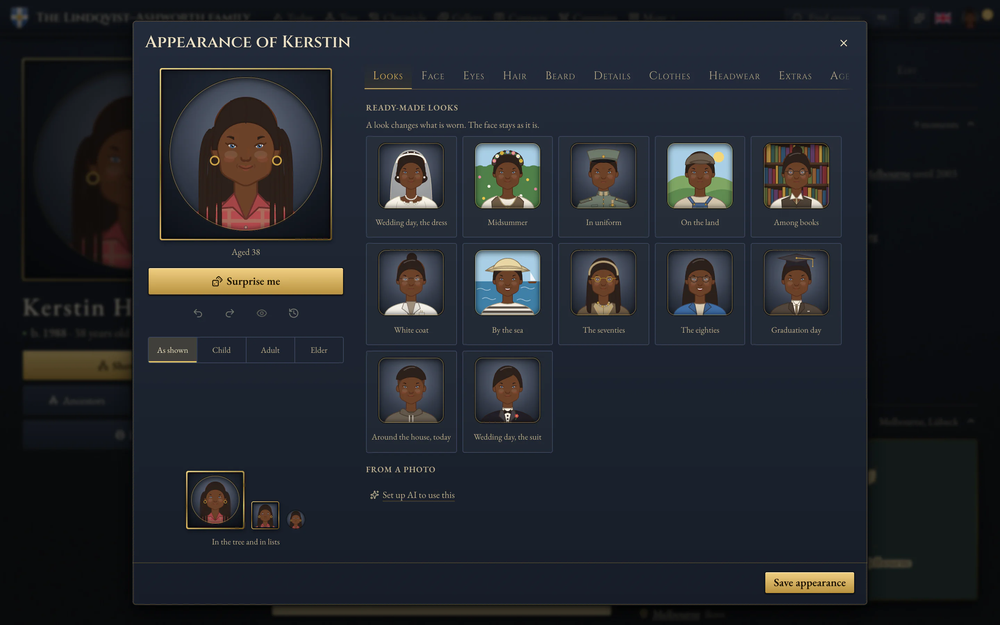
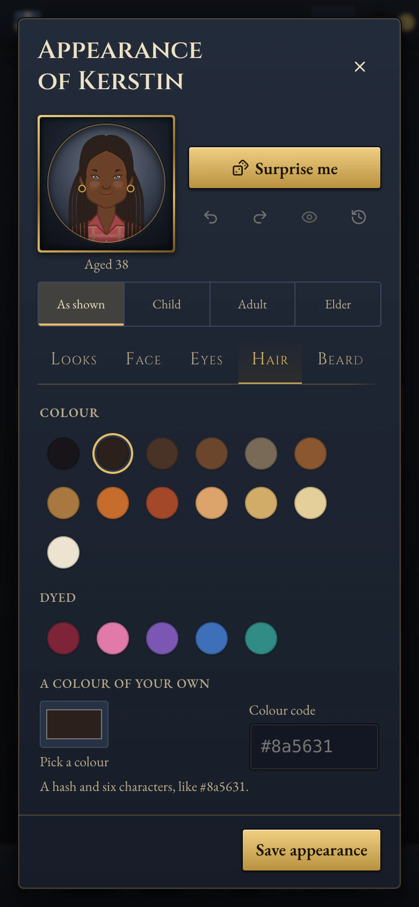

# Drawn portraits and the character editor

Every person in a family has a drawn portrait: a flat illustration built from parts, aged and dressed for the moment it
shows. Nobody has to make one. Until someone does, the portrait is automatic: it follows the person's sex and dates, so a
great-grandmother born in 1890 wears a high collar and greys with the years, and a child born in 2016 does not.

A photograph, or a portrait painted from one by the AI ([ai.md](ai.md)), can stand in for the drawing. The drawing stays
underneath, and a person can go back to it at any time.

## The character editor

Clicking a drawn portrait on a person's panel or page opens the editor. On a photograph or a painting, the small brush in
the corner does (the picture itself opens large). Editors also find it as **Appearance** on a person's Edit tab.

- **The portrait** on the left changes as you choose, and shows a choice while the pointer or the keyboard's focus rests on
  it. Under it are the same portrait at the size of a tree node and of a list row, and a preview of the person as a child,
  a grown-up and in old age.
- **Categories**: Looks, Face, Eyes, Hair, Beard, Details, Clothes, Headwear, Extras and Age. Each choice is a small picture
  of this person wearing it. "Automatic" leaves a part to the portrait, which is what every part is until someone sets it.
- **Hair** offers about twenty cuts first (cropped, textured crop, short and messy, side part, undercut, swept back, bob,
  curls, coils, long, a ponytail, a bun, receding, bald) and every other style under **More**. Its colour is a swatch, or
  **a colour of your own**: the browser's colour picker, or a code such as `#8a5631`.
- **Beard** is three choices: where it grows (stubble, full, goatee, circle, chinstrap, sideburns, mutton chops, soul
  patch), how long it is (short, medium, long, or a slider from 0 to 10), and how it is cut at the chin (round, square,
  pointed, forked). The **moustache** is chosen on its own (pencil, chevron, handlebar, walrus, more under More): a full
  beard with no moustache leaves the upper lip shaven. Beard and moustache take the hair's colour, or one of their own.
- **Surprise me** makes a believable relative: the same sex, age and time, the same skin (or a shade either side), a new
  face, hair and clothes. Headwear that is part of who someone is (a crown, a hijab, a turban, a kippah) stays.
- **Looks** are ready-made outfits for the person's own time: "Grandfather, 1950s", "Wedding day", "In uniform",
  "Midsummer", "Crowned". A look changes what is worn and never the face.
- **Undo** and **Redo** (also Ctrl+Z and Ctrl+Shift+Z, or Cmd on a Mac), **Back to how it was**, and **Compare with
  before**.
- **Save appearance** keeps it, as one entry in the family's History. Closing with unsaved changes asks first.

Everything works with the keyboard and a screen reader, at phone width (the portrait stays in view above the options), in
the three themes and the three languages. With "reduce motion" on, nothing moves.

## What a portrait can say

Skin in fourteen tones. Hair in natural and dyed colours or any colour of your own, straight, wavy, curly or coily, cropped,
textured, swept back or undercut, in braids, locs, cornrows, buns, a beehive or a crown braid, thinning, receding or bald;
greying that follows age until you set it. Eye colour and shape,
brows, nose, mouth, ears, the shape of the face, build, and lines of age. Freckles, a mole, a birthmark, vitiligo, a scar.
An expression: calm, a smile, a grin, stern. Beards by coverage, length and cut, in the hair's colour or their own, and a
moustache chosen separately. Glasses of a dozen kinds (a monocle and a pince-nez among them) and
the colour of the frames. A hearing aid, earrings, a necklace, a brooch, a medal, a scarf, a pipe, a bindi. Headwear by
time, faith and occasion: caps and hats, a headscarf, a hijab, a head wrap, a turban, a kippah, a prayer cap, a veil, a
uniform cap, a bridal veil, a flower crown, a crown. Clothes for every day, for Sunday, for work and service, and
traditional dress, in the house's colours or your own. A backdrop: plain, the house's colours, a studio drape, books, sky,
hills, a garden, the sea, the night.

Small symbols that would not read on a portrait the size of a thumbnail (a particular pendant, a badge of rank) are left
out. A plain pendant or a medal stands for them.

## Who may change a portrait

Whoever may paint a person's portrait may draw it: an **editor** or a **steward**, and the **member who is that person**
once a steward has confirmed the link on the Access page ([roles-and-privacy.md](roles-and-privacy.md)). The server checks
this on every save.

Everyone else in the family can still open the editor and try a look on; it says that nothing will be kept. The same
holds in a public demo and in a steward's "View as" preview. A guest of a share link gets the plain enlargement, as before.

## What is stored, and what never changes by itself

A look is a small JSON object on the person (`person.look`; `SeedLook` in `src/lib/seed-format.ts`). Only what someone
chose is stored. Every part is optional, and a part that is absent is drawn automatically from the person's id, sex and
dates, so it is the same on every screen and every day.

A portrait that is stored draws exactly as it did before a release, unless someone edits it:

- New parts are new optional fields, and absent always means "as before". Lists of colours and styles only ever grow at
  the end.
- The automatic choice of hair and eye colour draws from the colours that existed when it was written, however many are
  added.
- `src/lib/portrait-frozen.test.ts` draws some 3,300 stored looks at the three sizes and compares each with a kept print.
  If it fails, a stored portrait has changed: the drawing is wrong, not the fixture.

### Hair and beards were redrawn (the one exception)

Once, on purpose, every portrait changed: the hair, the beard and the moustache were redrawn for everyone, stored looks
included. The first drawing built every hairstyle from the same dome with the same dark outline, and they read as
helmets ("Cropped" was a skull cap one unit thick); a beard was a fixed shape with a skin-coloured patch painted over it
for the mouth, and a full beard covered the upper lip whatever moustache was chosen.

What changed, and what did not:

- Each hairstyle is now its own silhouette (`src/components/portrait/hair.ts`): an uneven outer edge, a hairline with
  temples and sideburns, a rim only where hair meets skin, the shadow of the fringe, a highlight. At list size it is the
  silhouette alone. A hat presses the hair down: nothing shows above it.
  The short cuts each have one cue that still reads on a tile: cropped hugs the skull under a straight hairline with
  square temples, short has a soft fringe, a side part shows its parting as a wedge of scalp beside the higher side,
  swept lays a fringe across the forehead, slicked is flat and glossy over a high forehead, a pixie has a choppy fringe
  and a wisp at each ear, an undercut is a slab over shaved sides, a textured crop stands up in spikes. (The fixture
  was printed a second time for the cases wearing these eight cuts, in the same release as the redraw.)
- A beard follows the face's own jaw (`beard.ts`), is drawn behind the lips with the mouth left open in its shape, and
  stops at the corners of the mouth. The moustache is drawn above the lips.
- **Stored ids keep their meaning.** A stored `long` beard is still a long full beard: `short`, `long` and `vandyke` are
  read as a full beard of length 2, a pointed full beard of length 9 and a pointed goatee (`BEARD_PRESETS` in
  `src/lib/portrait-look.ts`). The editor writes the coverage with `beardLength` and `beardShape` instead.
- A full beard whose moustache nobody chose is drawn with one, as it always looked. A look that says full beard and
  moustache "none" now shows a shaven upper lip: that is the one stored combination that reads differently.
- New optional fields, absent meaning "as the fields before say": `hairHex` (wins over the `hair` swatch, which stays as
  the nearest swatch), `beardHex` (absent: the hair's colour), `beardLength`, `beardShape`. A colour is `#rrggbb` and
  nothing else: it is checked when a look is saved and again when it is drawn, because it is written into the drawing.
- **Nothing else moved.** Before the redraw, prints were taken of every frozen case drawn without hair, beard and
  moustache (`portrait-frozen-rest.fixture.json`). With those three layers left out, the old and the new drawing are the
  same bytes, and the test keeps it so. The main fixture was printed again once, with the redraw.

Portraits are drawn at three levels of detail (`src/components/portrait/drawing.ts`): up to 40 px, up to 72 px, and
larger. A list-size portrait leaves out what would not show: a backdrop is flat colour there, and no part added later is
heavier at that size than the heaviest one before it (`src/lib/portrait-look.test.ts` checks both).

`/ui/character` is the developer's reference page: `?view=parts` shows every part on three sitters at two sizes,
`?view=family` the invented family above, `?view=matrix` every era and age.
